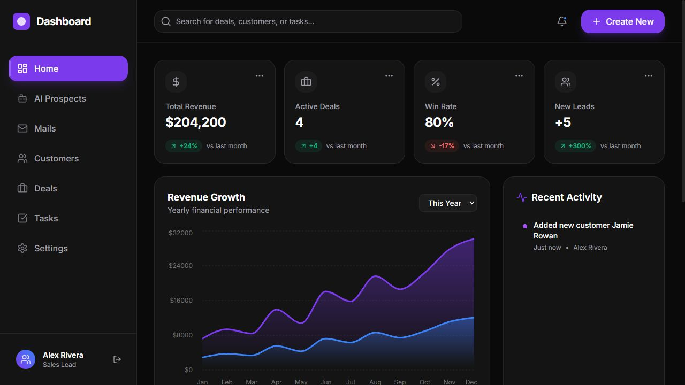
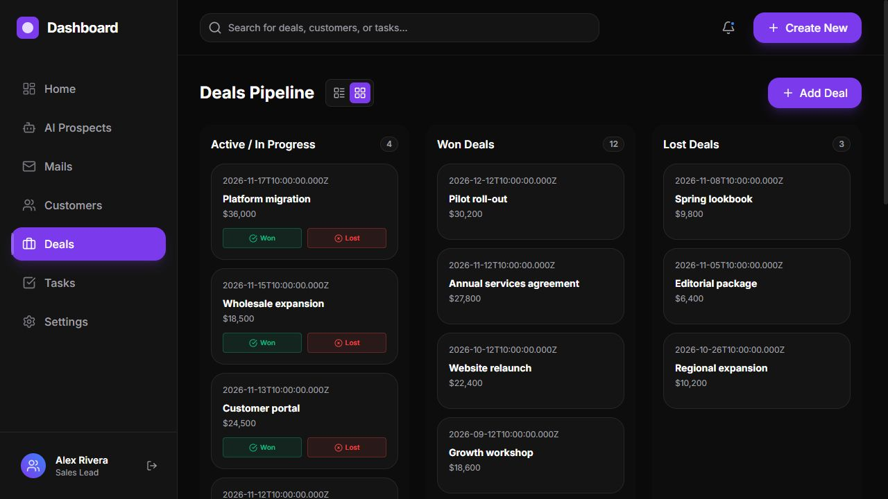
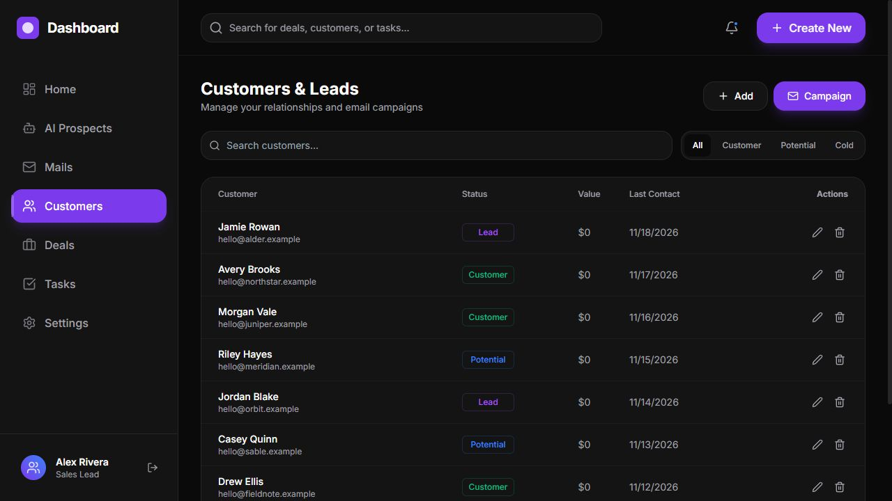
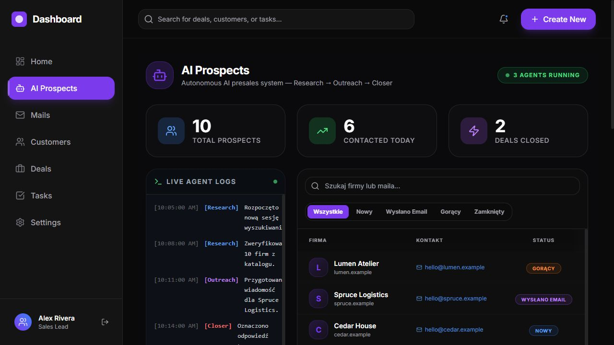

# CRM Dashboard

Panel CRM do zarządzania klientami, szansami sprzedażowymi i zadaniami. Łączy przegląd wyników sprzedaży z integracją Gmail oraz widokiem leadów i aktywności agentów AI.

**React · TypeScript · Vite · Tailwind CSS · Supabase**

## Przegląd sprzedaży

Przychody, aktywne szanse, skuteczność sprzedaży i nowe leady w jednym widoku. Wykres pokazuje wyniki w ujęciu miesięcznym.



*Wszystkie zrzuty przedstawiają aplikację uruchomioną lokalnie z fikcyjnymi danymi.*

## Pipeline sprzedażowy

Przenoś transakcje między kolumnami **Active**, **Won** i **Lost** lub przełącz się na listę.



## Klienci i leady

Wyszukuj kontakty, filtruj je według statusu i otwieraj szczegóły klienta. Powiązane zadania można przeglądać również w osobnym widoku listy lub kalendarza.



## AI Prospects

Monitoruj pracę agentów **Research**, **Outreach** i **Closer** oraz przeglądaj leady według statusu. Widok korzysta z Supabase Realtime do aktualizacji logów i leadów.



## Uruchomienie lokalne

Potrzebujesz Node.js 22.12 lub nowszego, npm oraz skonfigurowanego projektu Supabase z kontem użytkownika i tabelami CRM. Katalog `supabase/migrations` zawiera migrację szablonów wiadomości. Pozostałe tabele muszą istnieć w podłączonym projekcie.

```bash
git clone https://github.com/Diabue/crm.git
cd crm
npm ci
```

Utwórz plik `.env` w głównym katalogu i ustaw publiczne dane projektu Supabase używane przez aplikację przeglądarkową.

```dotenv
VITE_SUPABASE_URL=
VITE_SUPABASE_ANON_KEY=
```

Integracja poczty Gmail korzysta dodatkowo z `VITE_GOOGLE_CLIENT_ID` i `VITE_GOOGLE_API_KEY`. Analiza wiadomości przez Gemini korzysta z `VITE_GEMINI_API_KEY`.

```bash
npm run dev
```

Dashboard będzie dostępny pod adresem [localhost:5174](http://localhost:5174). Komenda `npm run build` zapisuje wersję produkcyjną w `dist/`.
